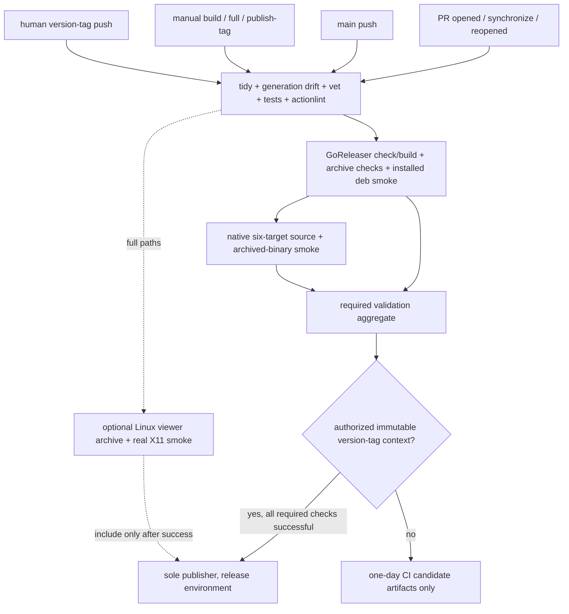

# Building, installing and releasing gtroff

The feature stack is unreleased. This guide describes the implemented candidate
pipeline, not an assertion that a GitHub release or native CI pass already exists.
Download published assets from [GitHub Releases](https://github.com/arran4/golang-gtroff/releases)
when available, or use the feature revision in the [user guide](../readme.md).

## Distributions and installation

| Distribution | Targets | Contents / runtime |
| --- | --- | --- |
| Headless `gtroff` | Linux, Windows, macOS; amd64 and arm64 | CGO=0, bundled fonts, executable, README, licenses, command docs and realistic examples |
| Linux packages | amd64 and arm64; deb, rpm, apk, Arch | `/usr/bin/gtroff`, man pages, completions, README, licenses, example source |
| Optional `gtroff-view` | Linux amd64 / X11 | Separate archive; CGO=0, display required; native pixel/input smoke required before including it |

The six headless targets are built and inspected in every candidate build. Full
native tests and archived-binary smoke are release requirements, with one runner
for each OS/architecture. Configuring a lane is not evidence that it has passed.
Linux amd64 has local runtime evidence; Linux arm64 has QEMU execution and
scenario evidence, including exact example image bytes. Windows amd64 has Wine
10.0 compatibility execution of its archived CLI and root/CLI test suites. Wine
does not establish native Windows filesystem or desktop support. Native
Windows/macOS remain pending while
hosted jobs fail before execution. The viewer's Windows source cross-build and
Apple backend remain preview work; neither is shipped by the viewer config.

Choose the archive matching your OS and architecture. Replace `VERSION` below
with the actual downloaded version; checksums cover archives, packages and source:

```sh
sha256sum --ignore-missing -c gtroff_VERSION_checksums.txt
tar -xzf gtroff_VERSION_linux_amd64.tar.gz
sudo install -m 0755 gtroff /usr/local/bin/gtroff
gtroff version
```

On macOS use `shasum -a 256` and compare with the checksum file. Windows archives
are ZIP files; compare `Get-FileHash -Algorithm SHA256` with the index, expand the
archive, and place `gtroff.exe` in a directory on PATH. No font files or browser
process need installing. macOS candidates are unsigned/unnotarized; this pipeline
does not claim Apple distribution approval or Windows signing.

Linux package installation uses the native package manager, for example:

```sh
sudo dpkg -i gtroff_VERSION_linux_amd64.deb
man gtroff-render
gtroff validate --strict /usr/share/doc/gtroff/examples/man-tool.1
```

The executable has no shared-library interpreter on Linux. Windows/macOS retain
their normal OS runtime interfaces. No groff, browser, fontconfig, X11 or C runtime
toolchain is a dependency of headless rendering. X11 is required only by the
optional Linux viewer. System search is explicit and gracefully optional.

## Generated documentation

The application generates its own man source from the exact command help text:

```sh
gtroff man > gtroff.1
gtroff man render > gtroff-render.1
gtroff completion bash > gtroff.bash
gtroff completion zsh > _gtroff
gtroff completion fish > gtroff.fish
gtroff completion powershell > gtroff.ps1
```

`go run ./cmd/docgen --write` atomically stages the fixed documentation set;
`go run ./cmd/docgen` checks it without writing. `go generate ./...` regenerates
that set as well as the parser tables and checks CLI examples. Normal tests do
not regenerate expectations. Generated man pages parse/build strictly through
the same AST and man model without invoking system groff.

Packages install Bash completion at
`/usr/share/bash-completion/completions/gtroff`, Zsh at
`/usr/share/zsh/site-functions/_gtroff`, and Fish at
`/usr/share/fish/vendor_completions.d/gtroff.fish`. Their permissions are 0644.
Bash scripts can also be sourced directly. Zsh uses its normal fpath/compinit
autoload mechanism; the first line is `#compdef gtroff`. PowerShell users can
dot-source `gtroff.ps1` from their profile. PowerShell is included in archives
and under the Linux package's documentation directory.

Completions suggest command/flag names and files; they do not execute gtroff,
resolve man roots or read remote resources. They do not currently complete
flag-value enums or selectors. Actual Bash/Zsh/Fish behavior is tested when those
shells are available; PowerShell behavior is tested on hosts with `pwsh`. All four
were executed locally for this implementation (PowerShell 7.6.7 on Linux).

## One owner workflow

`.github/workflows/ci.yaml` owns validation, candidates, native smoke and the
sole GitHub publisher. GoReleaser builds/packages only: both configurations set
`release.disable: true`. No other workflow or release action creates a release.
The publisher uploads the exact inspected candidate files; it never rebuilds.



PRs run one Linux source job, one candidate/package job and the strict aggregate.
They avoid the expensive native matrix. Main pushes, version tags and manual
`full`/`publish-tag` runs select the native matrix and optional viewer. There are
no ordinary feature-branch push runs, schedules, automatic tags or auto-merges.
The explicit `reopened` trigger preserves checks for the current stacked review
series. PR supersession cancels older PR work; it never cancels a release run.

Manual modes:

| Mode | Allowed context | Behavior |
| --- | --- | --- |
| `build` | branch or tag | Validate/build snapshot; never publish |
| `full` | branch or tag | Snapshot plus native matrix/viewer; never publish |
| `publish-tag` | existing `vMAJOR.MINOR.PATCH[-prerelease]` tag | Full validation and publication/recovery of that exact tag |

Tag publication verifies the dereferenced tag equals the selected SHA and is an
ancestor of origin/main, before building and again before publication. Manual
publication from a branch fails before checkout. There is intentionally no
version calculation/tag-preparation mode: maintainers choose and push an immutable
tag after review and merging the stack. No token-recursion assumption is needed.
This keeps tag creation a separate explicit maintainer action.

The aggregate uses `always()` and explicitly requires successful source,
candidate and selected native results. Failed, cancelled and unexpectedly skipped
checks cannot publish. Optional GUI build/linker failures cannot block headless
publication; GUI assets are omitted unless their own build, archive inspection
and actual X11 execution succeeded. Optional native desktop build attempts also
run on full lanes, without advertising those targets as shipped GUI support.

Workflow permissions are read-only except the publisher's `contents: write`.
Checkout does not persist credentials. The publisher is serialized per immutable
tag and bound to the `release` environment. Before the first publication,
maintainers should configure required reviewers on that environment and review
repository/tag rules; workflow YAML cannot establish environment protection.
A tag push or manual `publish-tag` is the explicit publication request. No release
or tag is created by local validation or an ordinary PR/main/snapshot run.

The generic publisher is the sole owner because GoReleaser OSS does not provide
the Pro split/merge publication handoff. It accepts existing releases only when
already published with the expected prerelease classification; it rejects draft
or classification conflicts. Recovery uploads the same intended tag's verified
assets. Stable and prerelease tags stay distinct; snapshots never publish.

## Local candidate verification

Use GoReleaser **2.18.3**, the version pinned by CI. CI downloads its official
Linux archive and verifies the recorded SHA-256 before execution. No `go mod tidy`
hook runs inside GoReleaser; check both modules first:

```sh
go mod tidy
go -C desktop mod tidy
git diff --exit-code -- go.mod go.sum desktop/go.mod desktop/go.sum
go generate ./...
git diff --exit-code
goreleaser check
goreleaser check --config .goreleaser-view.yaml
goreleaser release --snapshot --clean
go run ./cmd/releasecheck --dist dist --native
```

The checker verifies every archive target and package-format presence, all
published SHA-256 values, required documentation/examples/licenses, executable
format/architecture, `-trimpath`, and CGO=0 Go build metadata. Artifact/checksum
basenames and archive members reject Windows separators, drive/stream syntax and
unsafe directories even when inspected on Unix. Linux executables must lack an
ELF interpreter/shared-library dependency. It extracts the actual
host candidate into a temporary directory, empties PATH, checks version/commit/date
against release metadata, runs help/strict validation/HTML/PNG, decodes the PNG and
checks a strict negative case. It never rebuilds the candidate. Native matrix lanes
also require the actual host to match their OS/architecture label.

The Debian smoke installs the built package in `debian:bookworm-slim`, with
container networking disabled, and renders as `nobody`. Debian slim's documentation
exclusion config is removed in that disposable container so installed docs and
license readability are tested too. Docker and its Debian base image are test
infrastructure, not application dependencies. RPM/APK/Arch contents are generated
and checksummed; their package-manager install/runtime behavior is not claimed.

Optional viewer candidate:

```sh
goreleaser release --config .goreleaser-view.yaml --snapshot --clean
go run ./cmd/releasecheck --dist dist-view --viewer --native
```

Its archive must additionally pass the X11 test against the extracted binary,
using `-gui-binary /absolute/path/to/gtroff-view`; see [viewer.md](viewer.md).
`dist/` and `dist-view/` are ignored build output. In a dirty local checkout, source
archives represent committed HEAD; final release candidates must use a clean,
committed tree. Do not publish development snapshots.

## Windows compatibility probe

The Windows amd64 archive passed the same artifact-checker smoke under Wine
10.0: exact version/commit/date, help, strict positive/negative validation,
embedded-font HTML, and PNG decoding with an empty PATH. The Windows root and
internal CLI test executables also passed. This is compatibility execution on
Linux, not native Windows evidence.
An additional real-process probe covered filenames with spaces, selected AST,
byte-identical HTML/PNG/JPEG, HTML-to-roff conversion, strict destination
preservation and an HTTP server browsing the synthetic collection.

The complete HTTP library suite failed its symlink test under Wine. A standalone
Windows API probe reproduced `os.Symlink` returning success while `os.Lstat`,
`os.ReadDir` and `os.ReadFile` could not see the new link. The remaining HTTP tests
passed when that one test was isolated. No committed test was skipped or relaxed;
the native lane still requires the full symlink/containment contract. A cleanup
hook now closes the test root even if an assertion fails, preventing an unrelated
Windows sharing violation from hiding the first failure.

## Dependencies and hosted verification

New CI tools are GoReleaser 2.18.3 (build/package; digest verified) and actionlint
1.7.12 (workflow validation via a pinned Go module). They run without write tokens
or repository secrets. GitHub-maintained checkout/setup-go/upload/download actions
use their supported current majors. The publisher uses GitHub's runner-provided
`gh`; no additional release action or alternate publisher is introduced.
The sole write token is scoped to the final publication job. No container registry,
Homebrew/Scoop repository, announcement service or extra credential is configured.

Earlier hosted runs failed before executing steps. Later runs executed the full
source/package/native graph and exposed reproducible test and workflow defects;
see the dated [verification record](roadmap-verification.md#platform-evidence-and-remaining-acceptance).
A failed native source test is now fatal even when a later archive command would
succeed. Text checkouts use LF, with literal TXTAR bytes excluded from conversion.

A successful temporary combined candidate does not approve a release or establish
that the eventual merged main revision is identical. Full verification on the
exact release candidate, licensing issue #67, repository/release protection review
and an explicit human publication request remain required.

References: [current CI/CD standard](https://arran4.github.io/blog/post/2026/043-canonical-github-actions-ci-cd-super-reference/),
[GoReleaser conventions](https://arran4.github.io/blog/post/2026/023-assembling-goreleaser-yaml/),
[GoReleaser packaging](https://goreleaser.com/customization/package/nfpm/) and the
[read-only md2png reference](https://github.com/arran4/md2png).

The [roadmap verification record](roadmap-verification.md) maps each feature's
requirements to source/tests/artifacts and separates the remaining native/hosted
acceptance gaps from local results.
