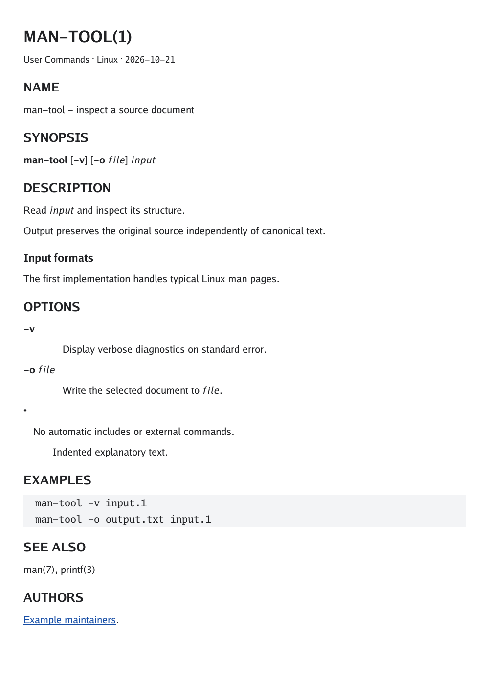
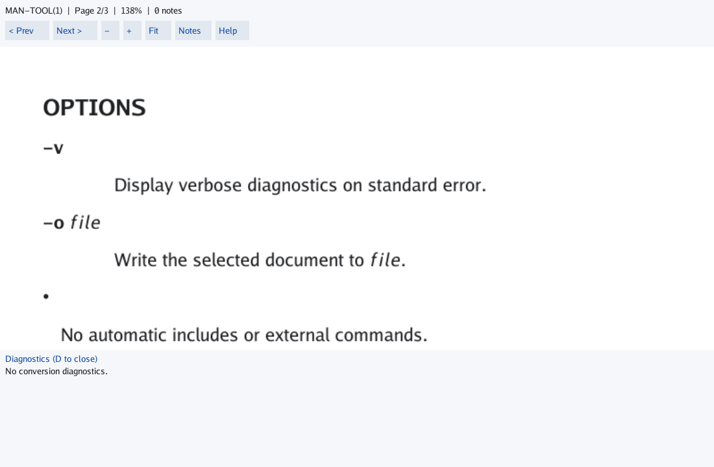

# golang-gtroff

> **Work in progress — public development preview.** This project implements a documented subset of roff/man; it is not a replacement for the full GNU groff toolchain. The CLI and APIs may change, and no stable binary release is available yet. See [documentation](docs/) and the [planned GitHub Pages site](https://arran4.github.io/golang-gtroff/) (available after publication is enabled).

Read Linux man-page source, inspect its structure, export HTML or paginated
PNG/JPEG, convert a supported HTML/man subset, and browse a local collection.
The headless CLI and libraries use pure Go with bundled Go fonts. They need no
groff, browser process, fontconfig, C compiler or installed man database.

[Example input](examples/man-tool.1) → [HTML](examples/man-tool.html),
[PNG](examples/man-tool.png), [dark JPEG](examples/man-tool.jpg),
[OPTIONS AST](examples/man-tool.ast.json), [validation](examples/man-tool.validation.json)
and [canonical roff](examples/man-tool.canonical.1).



## Install

These commands remain **unreleased development features**.
There are no published binary releases yet. Check the
[release page](https://github.com/arran4/golang-gtroff/releases) for future archives;
older revisions may not contain these commands.
The [release/install guide](docs/releasing.md) describes checksum verification,
archive/package contents and the publication gates. Snapshot candidates are
available as CI artifacts after successful builds; they are development builds.

From a checkout containing the merged features, use Go 1.26 or newer (tested: 1.26.10):

```sh
go build -o gtroff ./cmd/gtroff
```

Or install from the same reviewed checkout, with Go's bin directory on PATH:

```sh
go install ./cmd/gtroff
```

After a tagged release is published, remote installation can use
`go install github.com/arran4/golang-gtroff/cmd/gtroff@VERSION`. For library use,
use `go get github.com/arran4/golang-gtroff` with an appropriate reviewed revision.
The optional desktop command has a separate module and build below.

## Quick start

The small [synthetic page](examples/man-tool.1) contains NAME, SYNOPSIS,
DESCRIPTION, repeated formatting styles, OPTIONS, EXAMPLES and links. All commands
below run from this checkout. `# smoke` blocks are executed against a real binary
in tests; generated files go into a temporary directory there.

```sh
# smoke
./gtroff validate --strict examples/man-tool.1
./gtroff ast --select section:OPTIONS examples/man-tool.1 > options.json
./gtroff man render > gtroff-render.1
./gtroff completion bash > gtroff.bash
./gtroff render --format html -o page.html examples/man-tool.1
./gtroff render --format png -o page.png examples/man-tool.1
./gtroff render --format jpg --theme dark -o page.jpg examples/man-tool.1
```

Validation reports accepted syntax. Open `page.html` or either image to read the
result. `options.json` contains the selected nodes and the complete original
source snapshot, including original line endings. IDs are stable within that
snapshot. Omit FILE or use `-` to read stdin.

`validate` checks syntax rather than typesetting or semantic support. Unknown
requests produce warnings; malformed input fails. `--strict` rejects warnings.
Diagnostics go to stderr, or inside JSON for `validate --format json` and `ast`.
Exit codes are 0 success (possibly warnings), 1 invalid/strict, 2 usage/selection,
and 3 I/O/resource failure. [CLI details](docs/cli.md).

## Select content and control layout

```sh
# smoke
./gtroff ast --select section:OPTIONS --format text examples/man-tool.1
./gtroff render --section OPTIONS --theme dark -o options.html examples/man-tool.1
./gtroff render --format png --section OPTIONS --single -o options.png examples/man-tool.1
./gtroff render --format png --width 600 --page-height 400 -o pages.png examples/man-tool.1
./gtroff help render
```

The last render writes `pages-001.png`, `pages-002.png`, and so on. Single-page
output uses the exact requested name. Images on stdout require one page.
`--single` derives height within guarded limits; it does not crop overflow.
`--width`, `--margin` and `--page-height` use pixels. Image `--font-size` uses
points at `--dpi` (default 96); HTML font size uses CSS pixels.

AST selectors also accept `node:ID` and `path:/0/1`. Render `--node ID` takes an
AST source ID. Repeated matching headings select every matching section.
HTML `--fragment` emits a styled article; `--assets omit-fonts` makes a smaller
file that uses reader-side font fallback.

Four bundled Go faces are the default. To use an explicit font file:

```sh
./gtroff render --font-regular /path/to/regular.ttf --font-mono /path/to/mono.ttf -o custom.html examples/man-tool.1
```

Other faces retain bundled defaults. No font discovery runs automatically.
Missing raster glyphs are displayed as code-point labels and diagnosed.
[HTML options](docs/html.md) · [image layout and limits](docs/images.md).

## Inspect local source sets

```sh
./gtroff sources --format text document.1
./gtroff sources --no-includes document.1
```

The new workbench source loader resolves literal local includes beneath the input
file's directory or an explicit `--root`. It retains each file's original AST,
include relationships and source locations without evaluating roff. Stdin needs
an explicit root for include loading. [Source-set policy and Go API](docs/sources.md).

## Convert supported structure

```sh
# smoke
./gtroff convert --from html --to roff --strict -i examples/convert.html -o converted.1
./gtroff convert --from roff --to html -i converted.1 -o converted.html
```

Compare the [HTML input](examples/convert.html) with its
[canonical roff result](examples/convert.1). Headings, paragraphs, emphasis,
definitions, nested lists, preformatted text and safe links have semantic loop
contracts. Canonical output changes source spelling. Original bytes and
normalized semantics remain separate. Unsupported tags/CSS/scripts become
visible literal fallback with diagnostics; strict mode rejects them before
writing. [Supported profile and conversion contracts](docs/convert.md).

## Browse and search a collection

```sh
./gtroff serve --root examples --listen 127.0.0.1:8080
```

Open <http://127.0.0.1:8080>, search for `man-tool`, then follow OPTIONS or EXAMPLES.
The server indexes explicit directories once and serves a read-only snapshot;
restart to refresh. Plain and gzip man files work. Built-in search needs no system
utilities. To supplement it with an installed `apropos`/`whatis`, opt in:

```sh
./gtroff serve --root /usr/share/man/man1 --root /usr/share/man/man3 --system-search
```

Unavailable system search falls back to internal search with a notice. The
server defaults to loopback; remote listening requires explicit opt-in. Includes
and request parameters never resolve arbitrary files. [Server guide](docs/serve.md).

## Open the optional viewer

The optional desktop viewer can be launched directly via `gtroff view`:

```sh
./gtroff view examples/man-tool.1
```

If `gtroff-view` is not yet on your PATH, build it from the separate `desktop` module:

```sh
cd desktop
CGO_ENABLED=0 go build -o gtroff-view ./cmd/gtroff-view
./gtroff-view ../examples/man-tool.1
```

Scroll or drag, zoom with `+`/`-`, fit with `f`, switch pages with `n`/`p`, and
close with Escape. The separate module keeps Shiny out of headless dependencies.
`--section OPTIONS` opens a selection. On macOS use a native CGO/toolchain build.
[Controls, build options and native smoke procedure](docs/viewer.md).



## Platform scope and limitations

| Surface | Linux | Windows | macOS |
| --- | --- | --- | --- |
| Headless CLI, HTML, raster, server | Native CGO-free tests | Cross-built; native CI configured | Cross-built; native CI configured |
| Optional viewer | X11 / CGO=0 executed under Xvfb | Win32 / CGO=0 cross-built; runtime unverified | Native CGO backend configured; runtime unverified |

Hosted CI currently fails before running any steps; native Windows/macOS test
results are not established. [Tracked release/CI work](https://github.com/arran4/golang-gtroff/issues/29).

This is a bounded Linux-man subset, not full groff typesetting. Tables, equations,
macro evaluation, arbitrary CSS, complex shaping and all Unicode glyph coverage
are not promised. Unsupported content remains visible with diagnostics. Source
includes, commands and remote resources are never loaded by these rendering
workflows; the explicit `sources` workbench command resolves bounded local files.
The [opt-in evaluator](docs/evaluation.md) is separate from render/convert/serve;
it provides cancellation, resource limits, partial results and diagnostics for
preserved requests. It supports checked integer expressions, strings, register
updates, aliases and positional macro calls within a documented subset of roff.

Parser/evaluator/include/generator findings under
[#3–#17](https://github.com/arran4/golang-gtroff/issues/3) remain separate contracts.
[Specific parser dependencies](docs/ast.md#parser-dependencies).
Named outputs stage before per-file replacement; multipage replacement is not
atomic as a collection. Resource and strict failures preserve existing outputs.

## Libraries and development

[Library guide](docs/library.md) · [AST](docs/ast.md) · [semantic model](docs/man.md) ·
[executable AST example](ast_example_test.go). Choose the optional
[`man.Build` hierarchy](docs/man.md#optional-hierarchy-and-source-navigation) for
sections, paragraphs and definitions; its `Syntax()` and `SourceNodes()` accessors
retain the original AST and physical-line provenance, including comments and
opaque source. Rendering accepts structural AST
block IDs and physical lines inside captured regions, selecting their complete
semantic owner with its surrounding style and indentation context. `cmd/lex`
remains the legacy token inspection utility. Generated catalogue coverage is
not semantic support.
The [document reader](docs/document.md) also exposes exact captured source,
per-token raw bytes, partial results and configurable byte/line limits. AST
reader failures return a partial tree with positioned causes; `SourceComplete()`
distinguishes observed EOF from a captured prefix.
[Conversion imports](docs/convert.md#input-failures) retain captured source on
input failure and return positioned causes while leaving output untouched.
The [HTTP library](docs/serve.md) shares its raw/decode byte budget across roots
and failed page attempts, and aborts startup before listening when exhausted.
[Block handlers](docs/blocks.md) inspect bounded raw regions with exact headers,
bodies, terminators and spans; their registration never enables preprocessing
or external execution automatically. The semantic model follows captured block
boundaries, so stored headings and state changes cannot affect the surrounding
page. Definition variants keep their bodies
opaque; indirect end names require explicit delimiter state. Unresolved regions
remain visible with diagnostics.
The [syntax support report](docs/catalogue-support.md) lists every canonical
entry and the parser route exercised by tests, separately from evaluation.
The [argument API](docs/arguments.md) retains raw quoting/comments and byte spans;
checked formatting reports values it cannot encode faithfully. Generated line
parsers use declared fixed, repeating and raw-tail binding policies, so surplus
`.TH`/`.IP` fields produce diagnostics. Use `CanonicalToken` for checked typed
field formatting; exact source remains a separate snapshot.

```sh
go test ./...
go vet ./...
go run ./cmd/gen -check
go generate ./...
```

Generation rebuilds macro/request definitions, dispatchers and catalogue from
`cmd/gen/in.json`, `schema.go` and templates, regenerates
[the syntax support matrix](docs/generated/catalogue-support.json),
[man pages and completions](docs/generated), and **checks** committed CLI examples.
It does not refresh example expectations.

The parser generator renders/formats every output before writing. Generated
output batches stage first and restore earlier files if a later replacement
fails. [Generation and recovery limits](docs/generation.md) describe check mode,
owned staging and the single-writer contract.

To approve an example refresh:

```sh
go run ./cmd/examples --write
go test . -run '^TestIntegrationScenarios$' -update-integration
```

Run ordinary tests again and inspect text and images before committing. The
[shared scenario guide](docs/scenarios.md) explains cross-feature checks, both
conversion loops, binary snapshots and focused update commands. The semantic
model JSON uses `-update-man`; the viewer screenshot requires the explicit native
smoke capture documented in its guide. Neither is silently regenerated.

## Security

For coordinated reporting, secret-handling policies and security boundaries, see [SECURITY.md](SECURITY.md).

## License and provenance

Project-authored code is offered under **GPL-3.0-or-later**. Third-party fonts, fixtures, and GNU groff documentation retain their applicable original terms. See [LICENSE](LICENSE), [Licensing and provenance](docs/licensing.md), and the bundled [GFDL text](LICENSES/GFDL-1.3.txt).

**Publication clearance remains under review in [issue #67](https://github.com/arran4/golang-gtroff/issues/67)** until source-by-source coverage of descriptions embedded in generated Go is verified.
