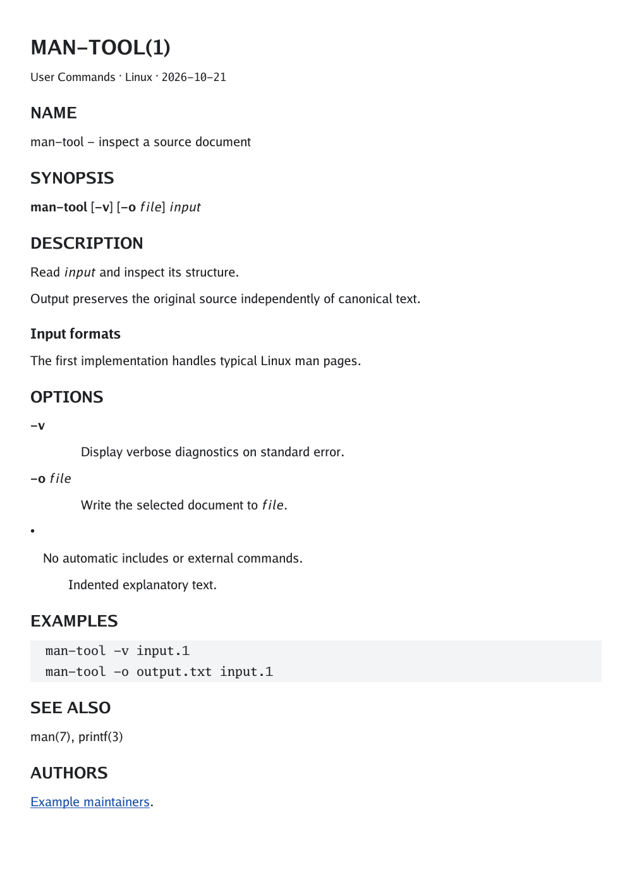
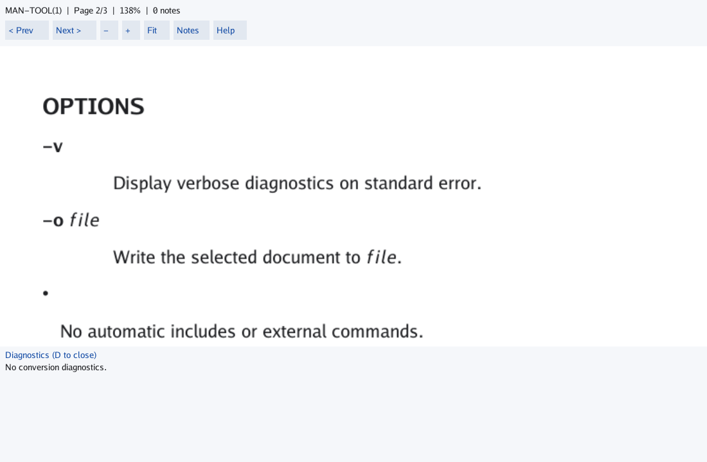

# golang-gtroff

A pure-Go library and CLI for reading, querying, analysing and rendering roff/man documents. Supports a documented subset of GNU groff; APIs may change before a stable release. [Documentation website](https://arran4.github.io/golang-gtroff/).

Read Linux man-page source, inspect its structure, export HTML or paginated
PNG/JPEG, convert a supported HTML/man subset, and browse a local collection.
The headless CLI and libraries use pure Go with bundled Go fonts. They need no
groff, browser process, fontconfig, C compiler or installed man database.

[Example input](examples/man-tool.1) → [HTML](examples/man-tool.html),
[PNG](examples/man-tool.png), [dark JPEG](examples/man-tool.jpg),
[OPTIONS AST](examples/man-tool.ast.json), [validation](examples/man-tool.validation.json)
and [canonical roff](examples/man-tool.canonical.1).



## Install

Build from a checkout with Go 1.26 or newer:

```sh
go build -o gtroff ./cmd/gtroff
```

Or install from the same reviewed checkout, with Go's bin directory on PATH:

```sh
go install ./cmd/gtroff
```

For Go library usage, see the [Go API examples](docs/go-api.md) and [library guide](docs/library.md). The optional desktop viewer has a separate build.

## Quick start

The small [synthetic page](examples/man-tool.1) contains NAME, SYNOPSIS,
DESCRIPTION, repeated formatting styles, OPTIONS, EXAMPLES and links. Run the commands below from the repository checkout.

```sh
# smoke
./gtroff validate --strict examples/man-tool.1
./gtroff ast --select section:OPTIONS examples/man-tool.1 > options.json
./gtroff man render > gtroff-render.1
./gtroff completion bash > gtroff.bash
./gtroff render --format html -o page.html examples/man-tool.1
./gtroff render --format png -o page.png examples/man-tool.1
./gtroff render --format jpg --theme dark -o page.jpg examples/man-tool.1
```

Validation reports accepted syntax. Open `page.html` or either image to read the
result. `options.json` contains the selected nodes and the complete original
source snapshot, including original line endings. IDs are stable within that
snapshot. Omit FILE or use `-` to read stdin.

`validate` checks syntax rather than typesetting or semantic support. Unknown
requests produce warnings; malformed input fails. `--strict` rejects warnings.
Diagnostics go to stderr, or inside JSON for `validate --format json` and `ast`.
Exit codes are 0 success (possibly warnings), 1 invalid/strict, 2 usage/selection,
and 3 I/O/resource failure. [CLI details](docs/cli.md).

## Select content and control layout

```sh
# smoke
./gtroff ast --select section:OPTIONS --format text examples/man-tool.1
./gtroff render --section OPTIONS --theme dark -o options.html examples/man-tool.1
./gtroff render --format png --section OPTIONS --single -o options.png examples/man-tool.1
./gtroff render --format png --width 600 --page-height 400 -o pages.png examples/man-tool.1
./gtroff help render
```

The last render writes `pages-001.png`, `pages-002.png`, and so on. Single-page
output uses the exact requested name. Images on stdout require one page.
`--single` derives height within guarded limits; it does not crop overflow.
`--width`, `--margin` and `--page-height` use pixels. Image `--font-size` uses
points at `--dpi` (default 96); HTML font size uses CSS pixels.

AST selectors also accept `node:ID` and `path:/0/1`. Render `--node ID` takes an
AST source ID. Repeated matching headings select every matching section.
HTML `--fragment` emits a styled article; `--assets omit-fonts` makes a smaller
file that uses reader-side font fallback.

Four bundled Go faces are the default. To use an explicit font file:

```sh
./gtroff render --font-regular /path/to/regular.ttf --font-mono /path/to/mono.ttf -o custom.html examples/man-tool.1
```

Other faces retain bundled defaults. No font discovery runs automatically.
Missing raster glyphs are displayed as code-point labels and diagnosed.
[HTML options](docs/html.md) · [image layout and limits](docs/images.md).

## Query documentation

```sh
./gtroff query 'section[name="ENVIRONMENT"] definition' document.1
./gtroff query --format csv --fields term,file,line 'definition' document.1
./gtroff query --view syntax --format raw 'macro[macro=".B"]' document.1
```

Selectors and typed Go builders share a stateless query representation. Choose
syntax or the optional man hierarchy; results retain original-file spans, source
identities and deterministic match ordinals. Named files use bounded local include
resolution, with `--no-includes` available. [Query grammar, Go API and output contracts](docs/query.md).

## Extract documentation records

```sh
# smoke
./gtroff extract --format csv --fields term,description,file,line definition examples/man-tool.1
./gtroff extract --format jsonl paragraph examples/man-tool.1 > paragraphs.jsonl
./gtroff extract --format html -o extracted.html definition examples/man-tool.1
```

Extraction separates query selection from records and output. Definitions keep
term/description, heading context, exact original spans, diagnostics and source
digests. For Great-Library-of-Environ-style input, select
`section[name="ENVIRONMENT"] definition` and export term/description/location
columns. Business classification and collection schemas belong to that project.
[Extraction API, exporters, includes and explicit atomic output](docs/extract.md).

## Agent query and extraction recipes

```sh
# smoke
./gtroff skills list --format json
./gtroff skills show --format json gtroff-query-extract
```

Bundled, versioned instructions explain selectors, source citations, diagnostic
limits and machine-readable extraction. Export to an explicit local parent with
`./gtroff skills export --dir ./chosen-skills gtroff-query-extract`.
Existing destinations are refused. [Portable assets, Go API and export policy](docs/agent-skills.md).

## Check structural policy

```sh
# smoke
./gtroff lint examples/man-tool.1
./gtroff lint --format json --fail-on warning examples/man-tool.1 > lint.json
```

Lint checks man section/definition conventions separately from syntax validation
and feature analysis. It supports explicit collections, scoped source-comment
suppression, JSON policies, trusted Go rules and CI thresholds. Named files use
the shared bounded include loader. Heuristic findings state their uncertainty;
manual-reference checks require an opt-in closed collection.
[Lint rules, API and failure policies](docs/lint.md).

## Explain document features

```sh
./gtroff analyze examples/man-tool.1
./gtroff analyze --format json --no-includes document.1
```

Analysis reports profile evidence, controls, escapes, definitions, references,
programmatic syntax, preprocessors and include states without executing roff.
Syntax recognition, man interpretation and rendering remain separate facts.
Custom declarative questions supplement the built-in inventory.
[Analysis API, rules and capability contracts](docs/analyze.md).

## Inspect local source sets

```sh
./gtroff sources --format text document.1
./gtroff sources --no-includes document.1
```

The new workbench source loader resolves literal local includes beneath the input
file's directory or an explicit `--root`. It retains each file's original AST,
include relationships and source locations without evaluating roff. Stdin needs
an explicit root for include loading. [Source-set policy and Go API](docs/sources.md).

## Convert supported structure

```sh
# smoke
./gtroff convert --from html --to roff --strict -i examples/convert.html -o converted.1
./gtroff convert --from roff --to html -i converted.1 -o converted.html
```

Compare the [HTML input](examples/convert.html) with its
[canonical roff result](examples/convert.1). Headings, paragraphs, emphasis,
definitions, nested lists, preformatted text and safe links have semantic loop
contracts. Canonical output changes source spelling. Original bytes and
normalized semantics remain separate. Unsupported tags/CSS/scripts become
visible literal fallback with diagnostics; strict mode rejects them before
writing. [Supported profile and conversion contracts](docs/convert.md).

## Browse and search a collection

```sh
./gtroff serve --root examples --listen 127.0.0.1:8080
```

Open <http://127.0.0.1:8080>, search for `man-tool`, then follow OPTIONS or EXAMPLES.
The server indexes explicit directories once and serves a read-only snapshot;
restart to refresh. Plain and gzip man files work. Built-in search needs no system
utilities. To supplement it with an installed `apropos`/`whatis`, opt in:

```sh
./gtroff serve --root /usr/share/man/man1 --root /usr/share/man/man3 --system-search
```

Unavailable system search falls back to internal search with a notice. The
server defaults to loopback; remote listening requires explicit opt-in. Includes
and request parameters never resolve arbitrary files. [Server guide](docs/serve.md).

## Open the optional viewer

The optional desktop viewer can be launched directly via `gtroff view`:

```sh
./gtroff view examples/man-tool.1
```

If `gtroff-view` is not yet on your PATH, build it from the separate `desktop` module:

```sh
cd desktop
CGO_ENABLED=0 go build -o gtroff-view ./cmd/gtroff-view
./gtroff-view ../examples/man-tool.1
```

Scroll or drag, zoom with `+`/`-`, fit with `f`, switch pages with `n`/`p`, and
close with Escape. The separate module keeps Shiny out of headless dependencies.
`--section OPTIONS` opens a selection. On macOS use a native CGO/toolchain build.
[Controls, build options and native smoke procedure](docs/viewer.md).



## Compatibility

The headless CLI targets Linux, Windows and macOS. The optional viewer requires a supported desktop backend. This is a bounded man-page subset, not full groff typesetting. See [compatibility](docs/compatibility.md) and [viewer requirements](docs/viewer.md).

## Create man pages from Go

The small [authoring façade](docs/author.md) constructs new canonical man pages
with typed paragraphs, definitions, subsections and literal examples. Constructors,
Add/Append methods and functional options reuse the existing escaping/writer
contracts. Output goes to an explicit writer; source-preserving editing is a
separate capability. See the executable examples in `author/example_test.go`.

## Go libraries

- [Library guide](docs/library.md) and [Go API examples](docs/go-api.md)
- [Source AST](docs/ast.md), [semantic man model](docs/man.md), [query](docs/query.md) and [extraction](docs/extract.md)
- [Feature analysis](docs/analyze.md), [lint](docs/lint.md), [authoring](docs/author.md) and [source loading](docs/sources.md)
- [Syntax support](docs/catalogue-support.md), [argument handling](docs/arguments.md) and [optional evaluation](docs/evaluation.md)

For contributors: [development](docs/development.md), [generation](docs/generation.md) and [scenario fixtures](docs/scenarios.md).

## Security

For vulnerability reporting and security boundaries, see [SECURITY.md](SECURITY.md).

## License and provenance

Project-authored code is offered under **GPL-3.0-or-later**. Third-party fonts, fixtures, and GNU groff documentation retain their applicable original terms. See [LICENSE](LICENSE), [Licensing and provenance](docs/licensing.md), and the bundled [GFDL text](LICENSES/GFDL-1.3.txt).
